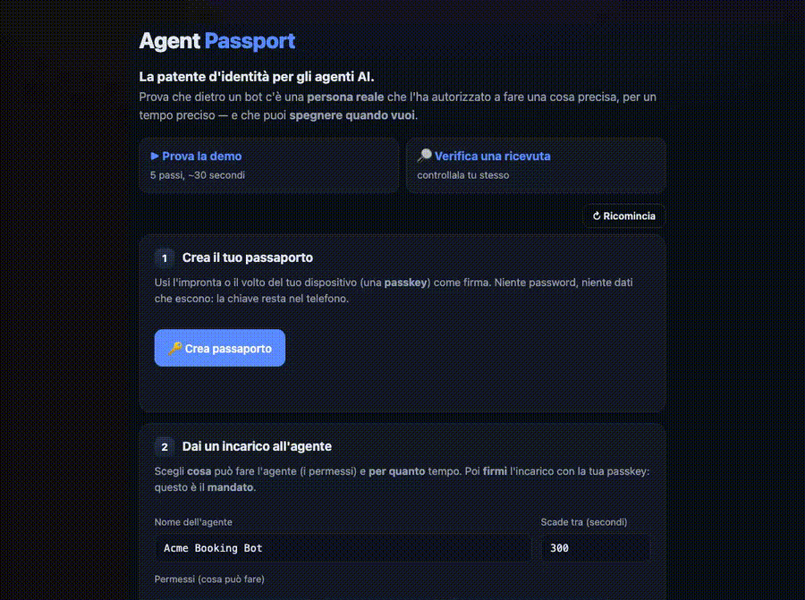
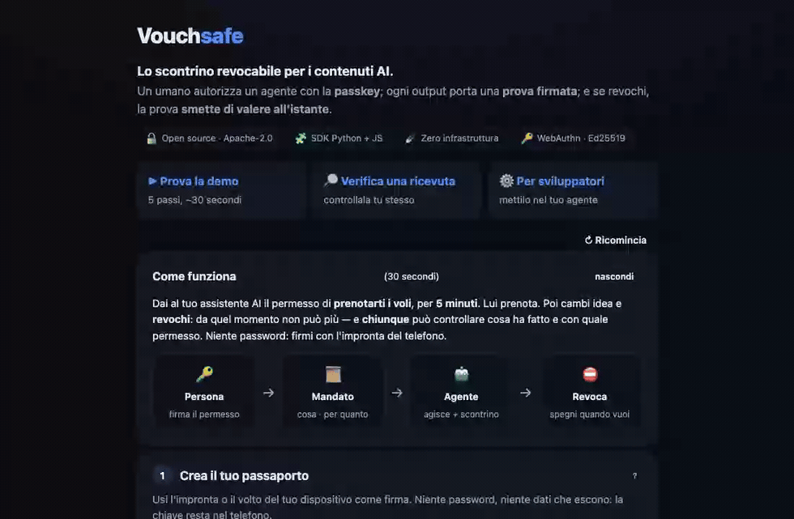

# Vouchsafe

**Lo scontrino revocabile per i contenuti AI.** Un umano autorizza un agente con la sua passkey;
ogni output dell'agente porta una **prova firmata**; e se l'umano **revoca**, quella prova
**smette di valere all'istante**.



*Stesso contenuto, stessa ricevuta. Prima della revoca: ✓ autentico. Dopo: ✗ non più valido.*

## Cos'è (in 2 righe)

Gli agenti AI producono contenuti e azioni al posto nostro. Vouchsafe lega ogni output a un
**mandato umano firmato con passkey** e gli allega uno **scontrino**: chiunque può verificare *chi
ha autorizzato questo output, per cosa, ed è ancora valido?* — e l'umano lo **spegne quando vuole**.

## Il fossato (cosa non fa nessun altro)

Tanti firmano l'identità di un agente o marcano "è AI" (Signet, C2PA, APS, AP2…). Una cosa sola
**non la fa nessuno sui contenuti**: legare la validità dello scontrino alla **revoca di un
consenso umano, in tempo reale**.

- **Signet** firma le azioni dell'agente ma le ricevute restano **valide per sempre** (audit-log immutabile).
- **C2PA / Content Credentials** prova *quale AI* ha generato — provenienza **statica**, niente consenso, niente revoca.
- **Notarized Agents** (arXiv) lega l'hash dell'output, ma la revoca **non è retroattiva** (l'opposto).
- **Google AP2** ha mandato-passkey + revoca real-time… ma nel dominio **pagamenti**, non sui contenuti.

Vouchsafe = *autorizzazione umana vivente sui contenuti*. La revoca uccide lo scontrino. Quello è il punto.

## Perché ora

- Oltre il **50% del traffico internet è bot** (2025); il traffico agentico cresce a tre cifre.
- a16z: *"il collo di bottiglia dell'economia degli agenti è l'identità, non l'intelligenza."*
- **EU AI Act Art. 50** (in vigore **2 ago 2026**): i contenuti AI vanno dichiarati in modo
  machine-readable. C2PA copre il *marking "è AI"*; Vouchsafe aggiunge il pezzo mancante —
  **"chi l'ha autorizzato, con che scope, è ancora valido?"** — come layer **complementare**
  (non un sostituto di C2PA, né "ti rende compliant da solo").

## Provalo in 3 comandi

```bash
cd packages/python && uv venv && uv pip install -e ".[server]"
cd ../../server && ../packages/python/.venv/bin/python run.py
# apri l'URL stampato (porta 8000 se libera, altrimenti la prima libera)
```

Autorizza un agente con la passkey → l'agente produce un contenuto con la sua ricevuta → premi
**revoca** e la ricevuta diventa non valida all'istante. Su `/verify.html` chiunque la ricontrolla.

## I due pilastri

```
  PERSONA ──firma con passkey──►  MANDATO  ──autorizza──►  AGENTE  ──produce──►  OUTPUT + RICEVUTA
     │                          (cosa·quanto)                                         │
     └──────── REVOCA ──────────────────────────────────────────────────────────────►┘
                                  revoca → la ricevuta muore in tempo reale · chiunque VERIFICA
```

1. **Content Receipt — lo scontrino (il cuore).** Una **ricevuta firmata** allegata all'output che
   lega `hash(byte del contenuto) + agente + mandato + tempo`. Certifica **autorizzazione al
   momento `producedAt`**, e la verifica riflette lo **stato corrente** del mandato: revochi → non
   verifica più. *Autorizzazione vivente*, non un timbro d'archivio immutabile (vedi `SPEC.md` §13.4).
2. **Mandato — il motore.** Un umano firma con la **passkey (WebAuthn)** un mandato per quell'agente:
   scope, scadenza, **revoca**. È la root di consenso che, revocata, uccide lo scontrino.



## Si aggancia alla compliance AI-Act

Lo scontrino è un **artefatto-prova machine-readable con stato vivo** (valido/revocato): esattamente
ciò che un audit trail Art.50/Art.12 dovrebbe avere e oggi non ha (sono PDF e checklist statiche).
Un tool di compliance può **emettere** la policy e **consumare/verificare** lo scontrino come prova
runtime che la policy è stata rispettata su *quei byte*. Il valore è il bit **"valido ORA / revocato"**.

## Cosa c'è nel repo

| | Dove | Verifica reale |
|--|--|--|
| 📐 Spec (mandato + Content Receipt §13 + delega + Threat model) | [`SPEC.md`](SPEC.md) | — |
| 🐍 SDK Python | [`packages/python`](packages/python) | `pytest` · 39 test |
| 🟨 SDK JS (Node 20+ / browser) | [`packages/js`](packages/js) | `node --test` · 14 (verifica token+ricevuta+catena emessi da Python) |
| 🔗 Catena di delega (sub-mandati più stretti) | [`delegate.py`](packages/python/vouchsafe/delegate.py) | nel suite sopra |
| 🌐 Demo web (passkey, revoca live, ricevuta, delega, `/verify.html`) | [`server`](server) | reale |
| 🤖 E2E (WebAuthn virtual authenticator) | [`e2e`](e2e) | `node run.mjs` · `receipt.mjs` · `chain.mjs` |
| ⚙️ **Integrazione** (CLI, hook Claude Code, esempi) | [`INTEGRATION.md`](INTEGRATION.md) · [`integrations/`](integrations/) · [`examples/`](examples/) | `python examples/standalone.py` |

> Sotto il cofano: W3C **Verifiable Credentials 2.0** come VC-JWT, **Ed25519/`did:key`**, e
> **WebAuthn** usato come firma del mandato. Zero dipendenze esotiche, zero infra.

## Lavoro correlato & come differiamo

Onestà: **non ho inventato un nuovo standard.** Mandato, delega, revoca, identità-agente esistono
già altrove. Vouchsafe combina tre cose che — *insieme, sui contenuti* — non ho trovato in nessuno:
(1) root di consenso **passkey umana**, (2) **scontrino sui byte dell'output**, (3) **revoca che lo
uccide live**.

| Progetto | Cosa fa | Come differiamo (onesto) |
|--|--|--|
| [**Signet**](https://github.com/Signet-AI/signetai) | Ricevute Ed25519 hash-chained sui tool call di un agente | Le ricevute Signet sono **immutabili** ("valid forever"), niente passkey umana, niente revoca che invalida il passato. Noi: **revoca → la ricevuta muore**, root **umana**. |
| [Microsoft **APS**](https://github.com/microsoft/agent-governance-toolkit) (Agent Passport System) | Ed25519, catene di delega, revoca a cascata, trust tier | Accountability **agent-to-agent**; **nessuna root WebAuthn umana**, nessuno scontrino sui **byte dell'output**. Noi mettiamo l'umano alla radice e firmiamo il contenuto. |
| [**Notarized Agents**](https://arxiv.org/html/2606.04193v1) (arXiv) | Receipt con hash dell'output | Revoca **non retroattiva** (i receipt passati restano validi) — l'**opposto** del nostro fossato. |
| [Google **AP2**](https://ap2-protocol.org/) (FIDO Alliance) | Mandato-passkey + revoca real-time | Ha (1)+(3) ma **nel dominio pagamenti**, non sui contenuti. Vouchsafe è AP2-applicato-ai-contenuti, standalone. |
| [**C2PA** / Content Credentials](https://c2pa.org/) | Provenienza del contenuto (citato da EU AI Act Art. 50) | Provenienza **statica/immutabile** ("quale AI l'ha generato"), niente consenso umano né revoca. **Complementare**, non in conflitto: idealmente lo scontrino è un'**assertion in un manifest C2PA**. |
| [**AIP**](https://datatracker.ietf.org/doc/draft-prakash-aip/) · [**UCAN**](https://github.com/ucan-wg/spec) | Delega/capability verificabili | Forti sulla delega multi-hop, ma **nessuna root umana WebAuthn** e nessun content receipt. Il nostro data-model di delega si ispira ad AIP. |

## Onestà brutale

Frontiera, non un incasso domani. **Non risolve la non-trasferibilità del root**: un umano può
prestare la sua passkey — diamo *responsabilità* (mandato+revoca), non prova di *unicità*. La passkey
firma un **hash opaco**, non lo scope leggibile: il consenso informato dipende dalla UI dell'issuer
(vedi `SPEC.md` §10 — limite più serio, dichiarato). Lo scontrino non sopravvive all'**analog hole**
(rifotografi/riscrivi → byte diversi) e non prova che il contenuto sia *vero*, solo *autorizzato*.
Revoca v1 = endpoint semplice, **fail-closed** senza grace (W3C Bitstring Status List + ZK = fase 2).
**Art.50 non lo copri da solo**: è un layer di accountability che *integra* il marking C2PA, non lo sostituisce.

Licenza: **Apache-2.0** (vedi [`LICENSE`](LICENSE)).

— Idea e architettura: [`CONCEPT.md`](CONCEPT.md) · integrazione: [`INTEGRATION.md`](INTEGRATION.md) ·
ricerca: [`docs/RESEARCH.md`](docs/RESEARCH.md) · bozza post: [`docs/LINKEDIN.md`](docs/LINKEDIN.md)
